<!-- Generated by scripts/make_readme.py. Edit profile.json to personalize. -->

  <h3><code>sixb5@github ~ $ ./contributions.sh</code></h3>
  
    
  <h3><code>sixb5@github ~ $ whoami</code></h3>
  <table>
    <tr>
      <td valign="top"></td>
      <td valign="top"></td>
    </tr>
  </table>
   
  
Characters. Contributions. A little context.

  
<a href="./SETUP.md">Setup &amp; customization</a> · <a href="./profile.json">Profile config</a>

